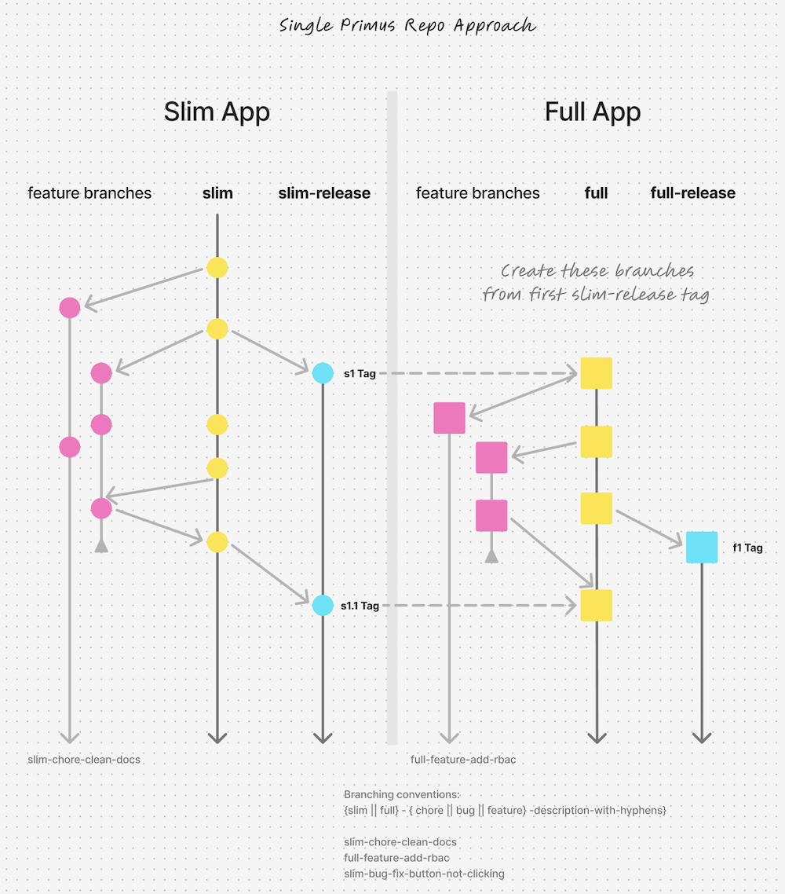

# Branching Strategy

**Updated By: Shayne Czyzewski**

**Updated On: 9/30/2024**

## Overview

Primus maintains two different flavors of the application:

- a `slim` branch that contains only the bare essentials for a new, STIG-compliant application
- a `full` branch that contains the `slim` branch plus all of the additional, opt-out functionality to make a full-featured application (e.g., RBAC)

Our setup is a simplified version of the popular [Gitflow](https://www.atlassian.com/git/tutorials/comparing-workflows/gitflow-workflow) branching strategy.

## Development Process

When developing a feature, it is important to determine what branch you should target for your MR. Foundational work that is required by all apps would go to `slim`. Work that is additive, but not required by the `slim` branch, would go to `full`.

Note: It is even possible that as you work on a feature for `full`, you may find that some of that work is also required by `slim`. In that case, you would want to move that work to a `slim` MR, and once merged, you could then use that in your `full` MR.

### Branch Naming

`[slim || full]-[chore || bug || feature]-[short description]`

Branch name example: `slim-feature-add-user-profile`

## `slim` to `full` merge process

Based on this branching strategy, your MRs will target either `slim` or `full`. The expectation is changes that land in `slim` will eventually make it into `full`. But how do you accomplish this?

1. Create a merge branch off the latest version of `slim`. You could do this through the UI, or locally with `git checkout slim && git pull && git checkout -b slim-to-full-<date>`.

1. Merge in the latest `full` into this merge branch. This should be done locally with `git merge origin/full` while on that new merge branch.

1. Resolve conflicts. What we are essentially doing in this merge branch, since `full` was originally branched from `slim`, is just overlaying all the `full`-specific changes on top of `slim`.

1. Push the merge branch to GitLab with `git push -u origin slim-to-full-<date>`.

1. Open an MR from this new merge branch. Hopefully, if we do it frequently enough, it will have only a small set of changes (i.e. the ones that were recently made to `slim`).

## Release Process

There are two release branches as well: `slim-release` and `full-release`. We merge the respective `slim`/`full` branches into those to create a release and add tags to the release branch. Whenever `slim-release` is updated, we will merge that over to `full`.

Tag name example: `slim-v1.0.0`
