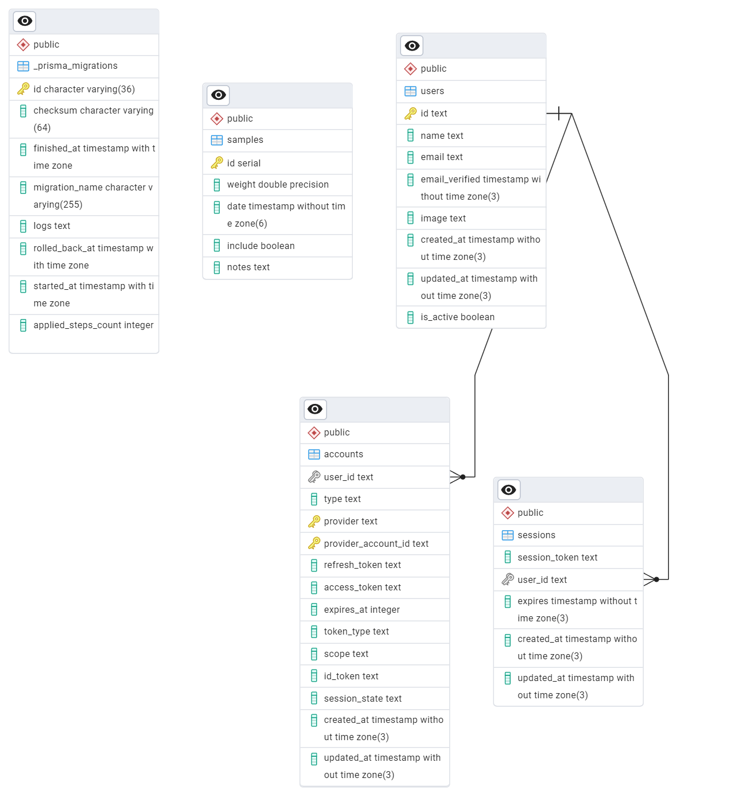

# Primus Schema

**Updated By: Miles Breman**

**Updated On: 9/4/2024**

## Overview

The Primus schema represents the architectural design of our database. For Primus base, without any additional modules we set up a basic sample set of data to establish the best practices for creating a CRUD app.

## Schema Diagram

- Last Updated: 9/4/2024
- Created Utilizing: EDR Tool from pgAdmin

## Sample Data

The samples table acts as a foundational element for testing CRUD functionality in the Primus base module. It allows developers to seed initial data and experiment with various operations, such as creating, updating, or deleting records. This ensures that the core functionalities are functioning correctly before integrating more complex features. The table captures a simple dataset, including numeric, timestamp, and textual data, simulating real-world use cases for demonstration and testing purposes.

## Authentication

The authentication workflow in Primus is powered by the users, accounts, and sessions tables. The users table stores basic user information, including their status, which is essential for managing active accounts. The accounts table links users to third-party providers for OAuth-based login systems, handling token management for secure access. The sessions table keeps track of both active and prior sessions, ensuring that authentication tokens are valid and tracking user activity for security purposes. Together, these tables establish a robust user authentication system that integrates easily with the Primus application.
