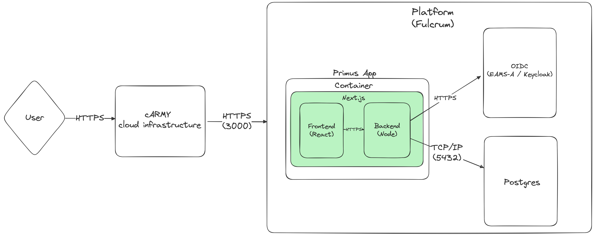

<!--
  NOTE: THIS MARKDOWN TEMPLATE IS NOT GITLAB FLAVORED, AND THUS WILL NOT RENDER CORRECTLY ON GITLAB
  IT IS DESIGNED TO BE RENDERED BY PANDOC INTO A PDF OR OTHER FORMAT. PLEASE REFER TO THE PANDOC
  DOCUMENTATION FOR MORE INFORMATION ON HOW TO DO THIS (https://pandoc.org/MANUAL.html#pandocs-markdown).

  THIS TEMPLATE IS DESIGNED TO BE USED WITH THE PANDOC CONTAINER IMAGE (https://code.levelup.cce.af.mil/cdso/containers/tool/pandoc)

  THERE ARE PORTIONS OF THIS TEMPLATE THAT SERVE AS A FORM TO BE FILLED IN, AND OTHERS THAT ARE
  MEANT TO BE EDITED. PLEASE REFER TO THE COMMENTS IN THE TEMPLATE FOR MORE INFORMATION.

  THERE ARE ALSO PORTIONS THAT ARE FILLED OUT IN THEIR ENTIRETY AND ARE TARGETED FOR THE
  CDSO APPROVAL SYSTEM. DO NOT EDIT THESE UNLESS YOU HAVE A COMPELLING REASON TO OR ARE DEVIATING
  FROM THE CDSO PROCESS.
-->

<!-- 
 PORTION MARKINGS:

 You must use portion markings for all paragraphs and headers in this document. You must have specified
 the top-level classification of the SDD in the front-matter of this document (under the 'classification' key).
   
 -->

## Responsible Organization

(U) Add the portion marking before each paragraph. This paragraph is marked as Unclassified, as denoted by the
'(U)' at the beginning of this paragraph.

(U) This section should contain information regarding your organization.  The rest of this template will
not contain portion markings as it is meant to be replaced in place of your SDD details.

### Points of Contact -- ISO/PM / ISSM/ ISSO

<!-- Refer to https://pandoc.org/MANUAL.html#tables for allowed table formats -->
<!-- We've provided the table below, but you can choose to provide this information in another format -->

+-----------------------------+---------------+-------------------------------------+
| Information System Security | Phone Number  |  NIPRNET Email                      |
| Manager Name                |               |                                     |
+=============================+===============+=====================================+
| Luke Pilkington             | 918-798-7455  | luke.j.pilkington.mil@army.mil      |
+-----------------------------+---------------+-------------------------------------+
| Michael Lenckos             | 847-220-2050  | michael.m.lenckos.mil@army.mil      |
+-----------------------------+---------------+-------------------------------------+

## Minimal Viable Product Software Process

### Definition of Minimal Viable Product (MVP) Software

A web application that:
* Is responsive, sleek, and uses modern design principles
* Is fully STIG compliant
* Demonstrates best software practices
* Has proper support for authentication 
* Provides out of the box integration with an identity provider - Keycloak
* Is configured to work with cDSO and their pipelines. 

### Process: Users and Roles

Standard User - A user that is able to interface with the application after having logged in with an identity provider. They can view and submit sample workout data from
the default dashboard view.  

## Software Overview

### Identification

<!-- Fill in this form's header with your project info and with an 'X' where applicable -->
```{=tex}
\begin{center}
\begin{tabular}{|c|c|}
\hline
\textbf{Software Name} & Primus \\
\hline
\textbf{Version}   & 1.0.0 \\
\hline
\end{tabular}

\begin{tabular}{|c|c|}
\hline 
 & \textbf{Software Type}  \\
\hline
 & Commercial Off-the-Shelf (COTS)  \\
\hline
 & Government Off-the-Shelf (GOTS)  \\
\hline
 & Free and Open Source Software (FOSS)  \\
\hline
 X & Contract-Developed / Modified Off-the-Shelf (MOTS)  \\
\hline
\end{tabular}

\begin{tabular}{|c|c|}
\hline
 & \textbf{Architecture}  \\
\hline
 & Installed on Desktop  \\
\hline
X & Application Server with Database  \\
\hline
 & Application Server with Persistent Storage  \\
\hline
\end{tabular}

\begin{tabular}{|c|c|}
\hline
 & \textbf{Users of the Software}  \\
\hline
& U.S. Army Cyber Command  \\
\hline
X & U.S. Army Cyber Command and other DoD organizations  \\
\hline
\end{tabular}

\begin{tabular}{|c|c|}
\hline
 & \textbf{Networks} \\
\hline
 & JWICS  \\
\hline
 & SIPRNET  \\
\hline
X & NIPRNET  \\
\hline
 & STEMSNET  \\
\hline
 & Stand-Alone (Name: )  \\
\hline
\end{tabular}

\begin{tabular}{|c|c|}
\hline
 & \textbf{Privacy Act Data} \\
\hline
 & "Business" or "Rolodex" PII  \\
\hline
 & PII  \\
\hline
 & PHI  \\
\hline
\end{tabular}
\end{center}
```

## Security Overview

### System Categorization

<!-- (highest classification of data processing, regardless of which network it sits on) -->
<!-- Fill in with the appropriate items and / or add any that apply -->


```{=tex}
\begin{center}
\begin{tabular}{|c|c|}
\hline 
 & \textbf{Anticipated Domain(s)} (CUI when filled out) \\
\hline
X & Unclass (IL2) (DEV)   \\
\hline
X & NIPRNet (IL5) (TEST, PROD)  \\
\hline
 & SIPRNet (DEV, TEST, PROD)  \\
\hline
 & JWICS (DEV, TEST, PROD)  \\
\hline
\end{tabular}

\begin{tabular}{|c|c|}
\hline 
 & \textbf{Anticipated Dissemination Controls (SIPR)} (CUI when filled out) \\
\hline
 & NOFORN   \\
\hline
 & FRD  \\
\hline
 & NATO  \\
\hline
 & ORCON  \\
\hline
 & PROPIN  \\
\hline
 & RESEN  \\
\hline
 & REL TO USA, AUS, CAN, GBR  \\
\hline
 & REL TO USA, AUS, CAN, GBR, NZL  \\
\hline
 & Other: (Please specify)  \\
\hline
\end{tabular}

\begin{tabular}{|c|c|}
\hline 
 & \textbf{Anticipated Dissemination Controls (JWICS)} (CUI when filled out) \\
\hline
 & SI-G   \\
\hline
 & TK  \\
\hline
 & HCS-P  \\
\hline
 & COMINT  \\
\hline
 & MASINT  \\
\hline
 & NATO  \\
\hline
 & REL TO USA, AUS, CAN, GBR \\
\hline
 & REL TO USA, AUS, CAN, GBR, NZL  \\
\hline
 & COMSEC  \\
\hline
 & Other: (Please specify)  \\
\hline
\end{tabular}
\end{center}
```

### Architecture Diagram



## Detailed Software Description

### Software Purpose / Goals

Primus is a comprehensive solution designed to expedite the development of web applications within the XVIII ABC. This repository houses a robust fullstack starter application that is extensible and ready for deployment. Developing for the Army can come with its own unique constraints and technical requirements. The goal of this project is to reduce the friction of these unforseen processes and requirements, allowing adopters to jumpstart their own development process. By forking this codebase developers receive a modern web app that supports: authentication, session management, secure data submission, and more - all right out of the box. Primus is made for developers by developers. And as such, adopters can expect: modern tooling, a simple local development setup, and a breadth of documentation. Our hope is for Primus to continously grow to meet the needs of the XVIII Airborne Corps and its developers.

### Software Functionality

The software achieves these goals by offering a fullstack web application that follows modern design principles, and uses leading industry technologies. Primus is developed using [Next.js](https://nextjs.org/) - an opinionated fullstack web application framework that enables developers to easily make server backed React applications. 
The application leverages [NextAuth](https://next-auth.js.org/) to handle authentication and session management. Postgres is used as the backing database for the application, where user details, sample data, and session information are securely stored. Primus uses [Prisma](https://www.prisma.io/) - a modern ORM to seamlessly interface with the aforementioned database. Most of the development is done in TypeScript, and [Vite](https://vite.dev/) is used for local development and testing. For ease of use when doing local development, a fully dockerized environment is provided to simplify the process of starting and working with Primus. 

Primus is containerized, fully STIG compliant, and ready for deployment through the cDSO pipeline. To simplify the process of adoption, we've also provided guides that cover topics like: getting started with Primus, customizing the application, and deploying the application.  

While developing Primus we've aimed to conform to best software practices; features added to Primus are accompanied by automated tests (both unit and E2E) and must satisfy our code coverage threshold. Linting tools are also immediately available, and developers using Microsoft's VSCode editor will also be recommended plugins that enhance the experience of developing for Primus. While by no means required, the Primus development team has also codified its own processes (found under `./documentation/contributor`), and other teams are welcome to use them as inspiration. 

### Software Components

#### Next App
The single deployable unit of Primus. This component is responsible for processing backend API requests and serving the frontend portion of the application. The unified codebase for Primus is housed under the `src/` directory. Most of the UI specific React code can be found under `src/components/`, `src/hooks/`. While portions of the backend code are handled by the routes contained under `src/app/api/`. Refer to [Next.js App Router docs](https://nextjs.org/docs/app) for more information. 

#### Postgres
The backing database of the application. This database is responsible for persisting and chronicling user submitted data, session information, and user details.

### User Interface

The user interface is served in the form of a modern responsive web application. The user is expected to reach the public facing
URL for the applicaltion to interface with it. In order to do so, the user is required to sign in with PKI. 

### Configuration Management

The application is configured by way of environment variables. An exhaustive list of these configurations can be referenced in `./.env.example`.

Configurations can be supplied via an `.env` file. Multiple configurations may be supported by sourcing from different `.env` files.

### Development and Testing

We follow an Agile software development methodology. This process is administered primarily through [GitLab](https://gitlab.cenithinnovations.com/h2f/primus/-/boards). Testing is conducted both locally and automatically as part of CI/CD pipeline steps. During these steps, automated unit tests are run against the codebase using [Vitest](https://vitest.dev/). Additionally, [Cypress](https://www.cypress.io/) is used for E2E testing. 

#### Milestones

Development progress is measured using traditional Agile Scrum methodology, with feature-work being carried out in multi-week sprints. Routine retrospectives are conducted on a per-sprint basis, where burndowns of completed story points are used to inform decision making in subsequent sprint planning sessions. 

Overall application success will been measured in terms of adoption and developer satisfaction.

#### Failure Conditions & Mitigations

Failure for this project would mean any continued disruption of the service itself. Or, if the process does not sufficiently provide guidance or value to other development teams. 

We've found that most failures typically originate from problems in our hosting environment and infrastructure. We intend to establish auditing and alerting processes in our new hosted infrastructure to better ensure our ability to promptly respond to outages or incidents. 

In order to ensure that Primus is delivering value to its adopters, we periodically conduct user interviews. At a later time, we may also look to auditing projects that are forked from Primus as a means of gathering additional insights. 

## Technical Overview

### Networking Capabilities

Our application must expose an external port to be interacted with over the internet. Similarly, it supposes that it can interface with an internally hosted Postgres database.  

### Ports / Protocol / Services

#### Ports
3000 - At this time the only external port exposed by our application. It's exposed by the web server and provides the functionality to the end-user.
5432 - The default port used by Postgres. 


#### Protocols
HTTPS - Protocol used between the user and the application 
TCP/IP - Protocol used between the application and Postgres DB

### Encryption
- Data in Transit: All communications between the application's components and external systems will be encrypted using HTTPS/SSL to protect data in transit. 
- Data at Rest: Sensitive data stored in the application's database will be encrypted to ensure confidentiality. The underlying pgcrypto module uses a combination of AES and Blowfish encryption standards. 

### Authentication
- Utilizes the Enterprise Access Management System - Army (EAMS-A) for authentication.
- We leverage NextAuth to simplify session management.

### Operating System

Our application has been built to run on the Alpine Linux distribution. 

The application container is derived from an Alpine base container, which in turn utilizes the Alpine Linux distribution. 

### Role-Based Access Control (RBAC)

At this time, Primus does not have an organizational notion of RBAC; there are no priveleged users or behaviors that require roles. 

<!-- START: DO NOT EDIT -->
### Audit Capabilities

This application uses the Continuous Integration (CI) services provided through Community
DevSecOps (CDSO), which is an inner-sourced CI solution provided for use within the
Department of the Army. The pipelines provided by CDSO are all open and auditable for
anybody within the department of the Army. The source code for all components can be found
here: <https://code.levelup.cce.af.mil/cdso>. The documentation can be found here: <https://cdso.pages.levelup.cce.af.mil/>.

### Dependencies

This application's dependencies can be viewed by looking at the pipeline artifacts for the most
recent CI iteration under the `syft-grype` job artifacts.

This job produces a `syft.json` artifact which contains the Software Bill of Materials (SBOM) for the
application image.

### Assumptions

List any assumptions made during the design of this application. This could include assumptions about
the network or operating environment, assumptions about the end-user, etc.

## Constraints

List what constraints there are that affect this application in its design, implementation, deployment, etc.

### Scanning Tools & Remediation

This application uses all of the scanning tools as defined in the `application-security-review`
Pipeline from CDSO. You can find details about the pipeline and its tools
here: <https://cdso.pages.levelup.cce.af.mil/components/pipelines/#application-security-reviewyml> .

Its definition can be found here: <https://code.levelup.cce.af.mil/cdso/cdso/-/blob/main/pipelines/application-security-review.yml>.

<!-- END: DO NOT EDIT -->

### Security Technical Implementation Guides (STIGs)

# Appendix A -- References

List relevant sources that were referenced throughout the rest of the SDD.

# Appendix B -- Acronyms

 |**Acronym**   |**Definition**
 |:------------:|--------------------------------------------------------
 | CDSO         | Community DevSecOps
 | CI / CD      | Continuous Integration / Continuous Deployment

## SRG (Security Requirements Guide)
